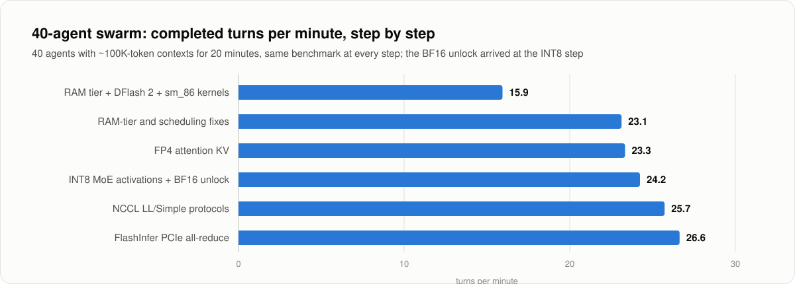
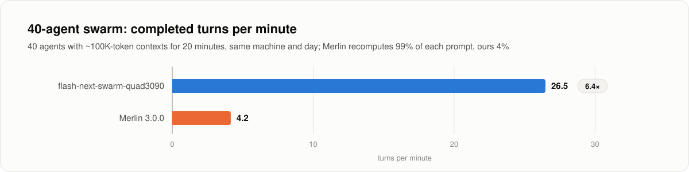
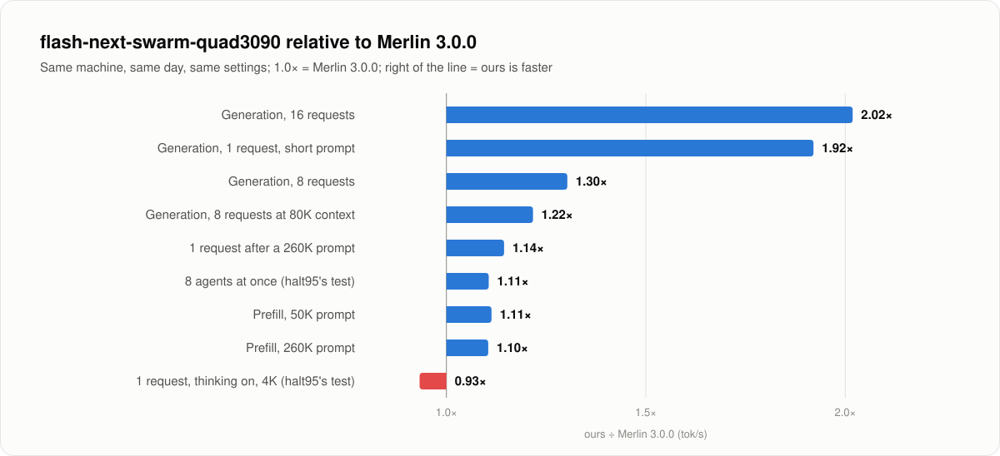

# flash-next-swarm-quad3090

<picture>
  <source media="(prefers-color-scheme: dark)" srcset="docs/images/hero-dark.svg">
  
</picture>

**Run a coding-agent swarm on four RTX 3090s without giving up answer quality.** flash-next-swarm-quad3090 builds on
[halt95's Merlin engine](https://github.com/halt95/merlin-engine) (Flash-Next v2.5.2) and serves halt95's 4-bit build of
[Swift 1.5](https://huggingface.co/ukisai/Swift1.5-Qwen3.8-Flash-Next), a post-train of Qwen3.8-Flash-Next (125B MoE),
tuned for many long conversations at once.

**[Results](#results) · [Quick start](#quick-start) · [vs Merlin 3.0.0](#compared-with-merlin-300) · [What it changes](#what-it-changes) · [Quality](#quality) ·
[Talk to it](#talk-to-it) · [RAM sizing](#ram-sizing) · [Recipe](docs/swarm/recipe.md) ·
[Blog post: how it works](https://ththeod.github.io/flash-next-swarm-quad3090/)**

- **Built for swarms.** A RAM KV tier keeps agent conversations warm: in a 40-agent run with ~100K-token contexts, 96%
  of prompt tokens are reloaded from RAM instead of recomputed, and the swarm completes 26.6 turns per minute.
- **More at once.** 16 requests decode together (1,144 tok/s in total), in a 1.21M-token VRAM pool.
- **Prompts get in fast.** 8,490 tok/s prefill, and a new 20K prompt still runs at 5,400-5,600 tok/s while eight
  80K-context requests are decoding.
- **Same answers.** Every change passed quality gates before it was kept: HumanEval 161/164 and MMLU-Pro 236/280 at
  `xhigh`, all needles to 260K, and identical output when a conversation resumes from RAM.
- **One command to install.** `./setup.sh` checks your machine, sizes the RAM tier for it, and verifies everything it
  downloads.

**Our version or Merlin 3.0.0?** Our version is built on Flash-Next v2.5.2, the release before halt95's current
[Merlin 3.0.0](https://github.com/halt95/merlin-engine) (vLLM 0.32, seven checkpoints, many more GPU setups). Use Merlin
3.0.0 for its checkpoints and hardware range. Use our version to run many coding agents with Swift 1.5 on 4× RTX 3090.

## Results

| Metric | Value |
|---|---|
| 40-agent swarm (~100K-token contexts, 20 min) | **26.6 turns/min**, 0 errors |
| Generation, 1 / 8 / 16 requests | **343 / 782 / 1,144 tok/s** (total over all requests) |
| Generation, 8 requests at 80K context | **815 tok/s** |
| Prefill, 10K / 50K / 260K prompt | **7,570 / 8,490 / 7,747 tok/s** |
| KV cache | **1,212,416 tokens** in VRAM (262K per request), plus a **130 GiB** RAM tier |
| Quality, `xhigh`, 64K budget | HumanEval 161/164, MMLU-Pro 236/280, all needles to 260K |

<sub>One machine, 2026-10-22/23, release configuration: 4× RTX 3090 with P2P, 256 GB RAM, the optional gpu-unlock and a
1400 MHz clock lock (power settings for your cards: [Hardware tuning](#hardware-tuning-optional)). Generation: short
prompts, thinking off, 512-token answers. The 80K row is a steady-state window from the long-context probe, which is
why it reads higher than 8 short requests. Swarm: 40 simulated agents shaped like a real coding-agent harness (MMLU-Pro
text, thinking off, fixed output lengths), measured for 1,200 s after warm-up; a turn took 76.5 s on average, 52.5 s of
it queueing for a slot. Prefill: one cold request. These methods differ from those in [README-halt95.md](README-halt95.md)
(thinking on, 220 W), so the two sets of numbers are not comparable; see [Compared with Merlin 3.0.0](#compared-with-merlin-300)
for a same-day comparison on this machine. Every run and its spread: [docs/swarm/results.md](docs/swarm/results.md).</sub>

<picture>
  <source media="(prefers-color-scheme: dark)" srcset="docs/images/swarm-steps-dark.svg">
  
</picture>

## Quick start

Needs four RTX 3090s with peer-to-peer, 96 GB of RAM or more and about 160 GB of free disk ([What you need](#what-you-need)).

```bash
git clone --branch swarm-v1.0 https://github.com/ththeod/flash-next-swarm-quad3090.git && cd flash-next-swarm-quad3090
./setup.sh            # checks the machine, shows every download with its size, asks once
scripts/run-swarm.sh  # OpenAI-compatible API on 127.0.0.1:8000
bench/check.sh        # quick checks against the running server (~10 min)
```

`setup.sh` runs halt95's v2.5.2 build script unchanged and then our changes on top, both verified by commit and tree
hash. It downloads the checkpoint and the drafter at pinned revisions, checks them against pinned SHA-256 lists, sizes
the RAM tier for your machine and writes `config/local.env`. Useful options: `--ckpt DIR` reuses a checkpoint you
already have, `--host 0.0.0.0` serves your network with a generated API key, `--systemd` installs the service,
`--build-own` compiles the engine extensions on older systems, and `--dry-run` shows the plan without changing
anything. `scripts/gpu-status.sh` shows the cards, peer-to-peer, power caps, the clock lock and the BF16 unlock. The
first start takes about 10 minutes while the server compiles its GPU code; later starts take about 5.5.

Every step by hand, plus BIOS settings and the P2P driver: [docs/swarm/recipe.md](docs/swarm/recipe.md).

## Compared with Merlin 3.0.0

halt95's current release and our version, on the same machine on the same day (2026-10-23), with the same settings
(gpu-unlock active, 1400 MHz lock) and the same benchmarks. Merlin 3.0.0 ran as its own launcher sets it up
for this checkpoint (`models/swift1.5/serve.sh`, profile fn-swift1.5-quad-3090: MTP K=3, FP8 KV, 8 requests at once,
no RAM tier). Both columns are single same-day runs (medians of three sends where a test sends three).

<picture>
  <source media="(prefers-color-scheme: dark)" srcset="docs/images/vs-merlin-swarm-dark.svg">
  
</picture>

<picture>
  <source media="(prefers-color-scheme: dark)" srcset="docs/images/vs-merlin-dark.svg">
  
</picture>

| Test | Merlin 3.0.0 | Our version |
|---|---|---|
| 40-agent swarm, ~100K-token contexts: turns/min | 4.15 | **26.48** |
| Swarm: mean turn / queue before a slot | 534 s / 425 s | **76 s / 52 s** |
| Swarm: prompt tokens recomputed | 99.3% | **4.1%** (the rest from the RAM tier) |
| Generation, 1 / 8 / 16 requests (short prompts, thinking off) | 156 / 586 / 557 | **300 / 764 / 1,124** |
| 8 requests decoding at 80K context | 659 | **802** |
| 1 request after a 10K / 50K / 260K prompt | 108 / 105 / 115 | **114 / 116 / 132** |
| Prefill, 10K / 50K / 260K (needle runs) | 6,892 / 7,418 / 7,003 | **7,526 / 8,256 / 7,737** |
| 8 × 80K prompts at once (640K tokens) | 82.3 s | **73.0 s** |
| A 20K prompt arriving next to 8 decodes at 80K | waits for a free slot (249 tok/s effective) | **5,402 tok/s** ¹ |
| halt95's "agents at once" test, 2 / 4 / 8 agents ² | 224 / 417 / 717 | **349 / 498 / 793** |
| halt95's decode ladder, 1 request, thinking on, 4K prompt | **183** | 171 |
| HumanEval, `xhigh`, 64K | 161/164 | 161/164 |
| MMLU-Pro 280, `xhigh`, 64K | 237/280 | 236/280 |
| Needles, 10K to 260K | all found | all found |

<sub>¹ Merlin runs at most 8 requests at once, so a ninth waits; ours runs 16. Our same-day figure is from a run of the
identical build earlier that day (the fresh install's first mixed batch compiles sampler kernels once).
² halt95's tests, re-implemented from the bench card (its drivers are not published). Merlin's run used ~20K-token
conversations instead of 16K (a bug in our script, since fixed); its 2-agent figure still matches halt95's own card
(223.7 vs 223.9 tok/s). A decode-ladder cell at 131K is left out until both builds have run with the fixed script.
Stock-card (no unlock) numbers for both builds, the way halt95 publishes Merlin, will be added.</sub>

**Where Merlin is ahead:** a single request with thinking on at short context, by about 7%. Thinking text is harder to
guess than code, and Merlin's 3 guesses per step most likely waste less work there than our 7. Everywhere else, and above all with many long
conversations, our version is ahead, at the same quality.

## What it changes

40 commits on halt95's v2.5.2, one change each, with its measurement in the commit message
(`release/swarm-v1.0/patches/0099..0138`). Why each one works, in plain terms:
[the blog post](https://ththeod.github.io/flash-next-swarm-quad3090/#how-it-works).

| Area | What changed | Effect |
|---|---|---|
| **Conversations stay in RAM** (RAM KV tier) | vLLM's CPU KV offloading made to work with this hybrid model: the DeltaNet layers' running state is saved at the end of every turn, and the next turn resumes from it. ARC eviction keeps long-lived parent conversations from being pushed out by bursts of short subagents. | 96% of a swarm's prompt tokens come back from RAM; about 4K tokens are recomputed per agent turn |
| **Better guesses** (speculative decoding) | the [DFlash 2](https://huggingface.co/incoai/Qwen3.8-Flash-Next-DFlash2) drafter instead of MTP: 7 guesses for one request, 3 for 2–8, 2 for 9–16 | 3.4–3.6 tokens accepted per step instead of 3.1; one request +53% on code |
| **More room** (KV cache) | 4-bit (FP4) attention KV, with attention kernels written for it, and a separate small cache for the drafter | 26–28% more tokens than 8-bit at the same speed: 1.21M tokens in VRAM |
| **8-bit math** (MoE activations) | the expert layers' inputs converted to INT8 (W4A8 Marlin), which GeForce runs at full rate; vLLM's INT8 path made to work with this checkpoint | prefill +11–12% on stock cards; a small cost on code ([Quality](#quality)) |
| **Less wasted work per step** (decode kernels) | matrix code sized for small batches on sm_86, small-batch MoE kernels, a cheaper next-token step | one request +23% |
| **Even groups on the assembly line** (pipeline) | equal decode micro-batches on the two pipeline stages | +34% at 16 requests |
| **Faster GPU traffic** (communication) | the custom all-reduce only between GPUs on the same PCIe root complex and for small messages; NCCL for large ones (`NCCL_PROTO=LL,Simple`); FlashInfer 0.7's PCIe all-reduce, as in Merlin 3.0.0 | a new 20K prompt next to eight 80K decodes is done in 3.6 s while they keep generating; +9–11% generation at 8–16 requests |
| **Fair queueing** (scheduling) | a request waiting for its RAM lookup keeps its place in line; extra saved states are dropped while memory is short | no mid-answer stalls in a full swarm |

## Quality

Each change went through the same gates before it was kept: a garbage and runaway detector, a NaN probe, needles, and
quality evals at `xhigh` reasoning with a 64K budget.

| Check | Result |
|---|---|
| HumanEval | 161/164 (repeat runs on this build family: 159-162) |
| MMLU-Pro, 280 questions | 236/280; BF16 activations 239, FP8 KV 232 (run-to-run noise about ±4) |
| Needles, 10K to 260K | all found |
| INT8 vs BF16 activations, teacher-forced perplexity on 64K documents | code +0.9% / +1.5%, prose ±0.04% |
| Conversation resumed from RAM vs from GPU memory, greedy | identical output |

INT8 activations cost a little on code perplexity and nothing measurable on the evals. `VLLM_MARLIN_INPUT_DTYPE=` (empty)
in `config/local.env` restores BF16.

## Talk to it

OpenAI-compatible chat completions at `http://127.0.0.1:8000/v1`, model name `flash-next-v2` (also `flash-next`):

```bash
curl http://127.0.0.1:8000/v1/chat/completions -H 'Content-Type: application/json' -d '{
  "model": "flash-next-v2",
  "messages": [{"role": "user", "content": "Write a haiku about four GPUs."}],
  "chat_template_kwargs": {"enable_thinking": true, "reasoning_effort": "xhigh"}
}'
```

- **Reasoning.** Thinking is on by default with `reasoning_effort` `"low"`. Ask for `"high"` or
  `"xhigh"` per request as above, or turn it off with `"enable_thinking": false`. `REASONING_EFFORT=xhigh` in
  `config/local.env` changes the server default; halt95's recipes default to `xhigh`, and our quality numbers use it.
- **Network.** `./setup.sh --host 0.0.0.0` serves your LAN and writes an API key to `config/local.env`; clients send
  `Authorization: Bearer <key>`.
- **Agents.** Point any OpenAI-compatible harness at the URL. 16 requests run at once and more queue. Tool calls
  (`qwen3_coder` parser) and reasoning are parsed.

## What you need

| | |
|---|---|
| GPUs | 4× RTX 3090 (24 GB), headless, PCIe Gen4 x16 each, with peer-to-peer ([P2P driver](docs/swarm/recipe.md#p2p)); no NVLink. Tested only with P2P. |
| System RAM | **96 GB or more.** The n-gram embedding table (47.7 GiB, FP8) must stay in RAM; what is left becomes the RAM tier. [RAM sizing](#ram-sizing) |
| Disk | about 160 GB free (checkpoint 115 GiB, drafter, engine and caches) |
| OS | Linux x86-64 with glibc 2.38 or newer for the prebuilt extension (Ubuntu 24.04, Debian 13); older systems: `./setup.sh --build-own` |
| Driver | NVIDIA with CUDA 13.0 or newer (R580+); tested on 610.57.04 (open, P2P build) |
| Software | Python 3.13 with headers (e.g. `uv python install 3.13`), git, curl, a C/C++ compiler, ninja |
| Power | stock cards: 220 W per card (halt95's reference); unlocked cards: 240 W per card and a 1400 MHz clock lock, with a PSU that has transient headroom ([power and clocks](docs/swarm/power-and-clocks.md)) |

## RAM sizing

**RAM tier ≈ visible RAM − 49 GiB (n-gram table) − 32 GiB (server, OS, headroom) − whatever else the machine runs.**
`/dev/shm` must hold the tier plus 5 GiB. One GiB of tier holds about 100K tokens of context, roughly one long agent
conversation. `setup.sh` applies the rule and caps it at the 130 GiB we measured unless you pass `--ram-tier`.

| Installed RAM | RAM tier | Good for |
|---|---|---|
| 64 GB | does not fit | |
| 96 GB | ~10 GiB | 1-8 agents |
| 128 GB | ~42 GiB | ~10-20 agents |
| 192 GB | ~104 GiB | large swarms |
| 256 GB | 130 GiB, measured (the rule allows up to ~166 on a dedicated machine) | 40-agent swarm |

Only the 256 GB row is measured so far. Details, and what a 64 GB machine would need: [docs/swarm/ram-sizing.md](docs/swarm/ram-sizing.md).

## Hardware tuning (optional)

GeForce Ampere runs BF16/FP16 tensor math with FP32 accumulate at half the workstation rate. Zagitta's
[gpu-unlock](https://github.com/Zagitta/gpu-unlock) module (not part of this project; use only this URL) lifts
that limit. It is volatile and needs a cold power cycle. On the same build it added 8–9% prefill, which then became
power-bound. How to set it up, check it and undo it: [docs/swarm/gpu-unlock.md](docs/swarm/gpu-unlock.md).

**Unlocked cards need a clock lock.** They draw short power spikes at the start of each burst of work, and these can
trip a power supply even when the average draw is well within its rating. Power caps react too slowly to stop them; a
clock lock contains them. For unlocked cards we recommend 240 W per card with a 1400 MHz lock; for stock cards,
halt95's 220 W and no lock. `scripts/run-swarm.sh` refuses to start on
unlocked cards without the lock. Details: [docs/swarm/power-and-clocks.md](docs/swarm/power-and-clocks.md).

## Known limitations

- Single-request decode depends on the text: 300-343 tok/s on short prompts, about 115-130 tok/s right after a long
  prompt of exam questions. With thinking on at short context, Merlin 3.0.0 is about 7% faster.
- Rare generation loops can run to the token cap (1 of 164 HumanEval items at 64K), as on every build we tested.
- The first batch that mixes greedy and sampled requests after a fresh install or a configuration change stalls once
  for ~6 s while sampler kernels compile.
- A full swarm preempts requests (about 190 in 20 minutes at 40 agents); they resume from the RAM tier.
- Prompt logprobs are refused with HTTP 400: a 1024-token chunk of them runs the last pipeline stage out of memory.
- The server uses the checkpoint's own chat template. Merlin 3.0.0 serves a fixed Qwen3.8 template (froggeric's) that
  keeps the prefix cache when an agent adds a system message after the first turn; adopting it is planned once it has
  passed our swarm and quality runs.
- `MemorySwapMax=0`, which keeps the n-gram table out of swap, applies when the server runs as the systemd service, not
  when you start `scripts/run-swarm.sh` by hand on a machine with swap.
- Image input is enabled as in halt95's release but was not part of our tests with the RAM tier and DFlash 2.
- Tested on one machine so far, with peer-to-peer. Boards differ in PCIe layout and power delivery, so your numbers may
  differ; reports are welcome as [issues](https://github.com/ththeod/flash-next-swarm-quad3090/issues).

More, including what we tried and dropped: [docs/swarm/troubleshooting.md](docs/swarm/troubleshooting.md).

## Credits

- **halt95**: the Merlin engine and the Flash-Next recipe ([merlin-engine](https://github.com/halt95/merlin-engine)), the
  [Merlin checkpoint](https://huggingface.co/halt95/Qwen3.8-Flash-Next-W4A16-Merlin), the
  [Swift 1.5 build](https://huggingface.co/halt95/Swift1.5-Qwen3.8-Flash-Next-W4A16-Merlin) and its
  [recipe](https://github.com/halt95/Swift1.5-qwen38-flash-next-3090s), and the KV scales. This project starts at halt95's
  v2.5.2 release, its build runs halt95's build script unchanged, halt95's 98 engine commits keep their authorship, and
  halt95's README is kept as [README-halt95.md](README-halt95.md). The RecoverSSM boundary fix (patch 0138) is ported
  from Merlin 3.0.0, and FlashInfer's PCIe all-reduce is switched on as halt95 does there.
- Everyone halt95 credits for v2.5.2, whose work this project inherits ([README-halt95.md](README-halt95.md#credits)),
  among them the [peakcrosser7 Flash-Next branch](https://github.com/peakcrosser7/vllm/commits/release/qwen38next_offload)
  behind vLLM PRs #53896 and #53899, and [CoolShades](https://github.com/CoolShades) (the idle-power fix in v2.5.2).
- **Qwen** ([Qwen3.8-Flash-Next](https://huggingface.co/Qwen/Qwen3.8-Flash-Next)), **UkisAI**
  ([Swift 1.5](https://huggingface.co/ukisai/Swift1.5-Qwen3.8-Flash-Next)), **incoai**
  ([DFlash 2 drafter](https://huggingface.co/incoai/Qwen3.8-Flash-Next-DFlash2)), **Intel** (AutoRound INT4 experts),
  **RadixArk** (FP8 n-gram table), **DominikBucko** (MTP INT4 packing recipe), **Zagitta**
  ([gpu-unlock](https://github.com/Zagitta/gpu-unlock)), **aikitoria** (P2P kernel modules),
  [vLLM](https://github.com/vllm-project/vllm) and [FlashInfer](https://github.com/flashinfer-ai/flashinfer).
- Juntian Liu: vLLM #57632 (DFlash context K/V precompute in the draft CUDA graph), backported as patch 0109.
- The two W4A8-INT8 Marlin fixes (patches 0136 and 0137) were found independently; fixes by other authors are open
  upstream: vLLM #61405 by ntovas (the missing global scales), #48926 by lazypool (signed group scales) and #59895 by
  plawanrath (absolute-maximum normalization).
- flash-next-swarm-quad3090: [ththeod](https://github.com/ththeod), developed with [Claude Code](https://claude.com/claude-code).

This is an independent derivative. It is not made, reviewed or endorsed by halt95, UkisAI, Qwen or incoai. If this
work helps you, consider supporting the engine it is built on: [halt95 on Ko-fi](https://ko-fi.com/halt95).

## License

Code: Apache-2.0 (`LICENSE`), as halt95's engine and vLLM. `NOTICE` lists every file this project adds or modifies
relative to halt95's v2.5.2 release (Apache-2.0 §4(b)). `bench/data/` holds GSM8K, HumanEval and MMLU-Pro (MIT; see
`bench/data/README.md`). This repository ships no model weights. The checkpoint is under the Swift Open License v1.0
and the Qwen Community License 1.0; read halt95's
[licence summary](https://github.com/halt95/Swift1.5-qwen38-flash-next-3090s#license) before commercial use. The DFlash 2
drafter is Apache-2.0. This is not legal advice; the licence texts govern.
