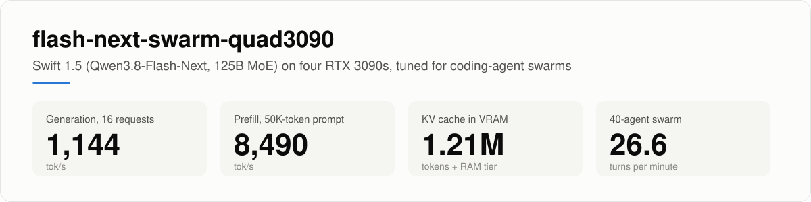

# Four RTX 3090s, one 125B MoE, forty coding agents

*How we got Qwen3.8-Flash-Next to serve a swarm of coding agents on consumer GPUs without giving up quality. ththeod, October 2026.
Code, patches and benchmarks: [github.com/ththeod/flash-next-swarm-quad3090](https://github.com/ththeod/flash-next-swarm-quad3090)*

<picture>
  <source media="(prefers-color-scheme: dark)" srcset="assets/hero-dark.svg">
  
</picture>

We wanted one machine to keep up with a swarm of coding agents. Our harness splits a task across dozens of
subagents, and each one carries a long conversation, usually more than 100K tokens. The machine has four RTX 3090s
running Swift 1.5, a fine-tune of Qwen3.8-Flash-Next, which is a 125B-parameter mixture-of-experts model.

halt95's [Flash-Next engine](https://github.com/halt95/merlin-engine) is the reason a model this size runs on 3090s at
all, and it is already built for agents. But its GPU cache fits fewer than ten conversations of that length. In a
swarm of forty, almost every turn starts by recomputing a prompt from scratch.

This post is about the 40 changes we made on top of halt95's v2.5.2 to fix that. The main ones are a 130 GiB RAM
tier that keeps conversations warm, a better drafter, a bigger KV cache, shorter decode steps and faster communication
between the GPUs. On the same day, our 40-agent benchmark ran at 26.5 turns a minute on our build and 4.2 on
halt95's latest release, Merlin 3.0.0. Both builds scored the same on HumanEval and MMLU-Pro.

All of our numbers come from one machine. It runs the optional third-party BF16 unlock (section 7) and a 1400 MHz
clock lock. The [results page](https://github.com/ththeod/flash-next-swarm-quad3090/blob/swarm/docs/swarm/results.md)
lists the exact conditions. Numbers for stock cards will follow.

## The problem

In an agent conversation, each turn resends everything so far, plus a little more: the latest tool output and the
next instruction. If the server still has the earlier part cached, it only has to process the new part. halt95's
engine does this well. With 8 agents, 93% of follow-up tokens come from its cache.

Our workload is bigger. The median subagent prompt in our harness is about 114K tokens, so forty agents need about
4.5 million tokens of cache between them. The GPUs hold about 925K. Whatever doesn't fit is evicted and later
recomputed, at a few thousand tokens per second, while the agent waits.

So we wanted a server that keeps many long conversations warm, decodes many requests at once, and lets a fresh
prompt in without stalling everyone else. And every answer had to be as good as before.

## How we measured

Two benchmarks drove the work.

The first is a **40-agent swarm** (`bench/swarm_bench.py`). Forty simulated agents run for 20 minutes after a
warm-up. Their prompt sizes, answer lengths, subagent fan-out and tool time follow aggregate statistics from our real
harness. The text is MMLU-Pro questions, so the benchmark can be published. Answer lengths are fixed, so runs can be
compared. It reports completed turns per minute, queue time, time to first token, and where each prompt token came
from: recomputed, the GPU cache or the RAM tier.

The second is a **long-context probe** (`bench/prof_longctx.py`). Eight requests decode at 80K context while a new 20K
prompt arrives. That is the exact moment a swarm stalls.

Every candidate also had to pass these quality gates:

- a detector for garbage and runaway output;
- a NaN probe;
- needle-in-a-haystack tests from 10K to 260K tokens;
- HumanEval and MMLU-Pro at `xhigh` reasoning with a 64K-token budget;
- perplexity checks for precision changes;
- a test that a conversation resumed from RAM produces exactly the same tokens as one resumed from the GPU cache.

A change that failed was dropped, however fast it was.

Each change got a clean run of its own: a fresh boot on all four GPUs, the same fixed probes and gates, and a
baseline measured the same day. We did 64 of these runs in four days. When two changes interacted, we tested them
alone and together.

To decide what to try, we profiled. The four GPUs run as two pipeline stages of two GPUs each. We captured
torch-profiler traces of both stages and wrote small tools on top of them. The most useful one splits a decode step
into each stage's compute, the hand-off between stages, and the time spent waiting on all-reduces, the step where GPUs
combine their partial results. Kernels that looked slow got their own microbenchmarks.

One of our own tools misled us at first. Our GEMM tuner timed each matrix shape back to back. Under the power cap,
that throttled the cards to about 330 MHz, so the tuner was picking plans from the timings of a heavily throttled
card. Idle gaps between runs fixed it.

## What we changed

Each section below covers one area of the work. The patches are in `release/swarm-v1.0/patches/`, and each commit
message includes its own measurement.

### 1. Keep agent conversations in RAM

vLLM can already copy KV-cache blocks to system RAM and load them back later. Flash-Next makes that harder, because it is
a hybrid. Alongside attention, it has DeltaNet layers, which don't keep a cache per token. Instead, they keep one
running state that sums up everything so far, and that state only exists where it was saved. So, to resume a conversation from RAM, the server
needs two things: the attention blocks, and a saved state at exactly the token where the next turn starts. It also
has to keep working with halt95's RecoverSSM, which rebuilds that state after speculative decoding.

The first bug we found corrupted data. The two pipeline stages hold different layers, so they worked out different
block sizes. They then wrote over each other's slots in the shared RAM region, and reloaded conversations came back
wrong.

The second bug was about where a turn resumed. Lookups stopped at the newest saved state, one or two blocks before the
end of the prompt, so every agent turn recomputed about 15K tokens. Now a turn resumes from the state saved at the
end of the previous turn, which cut that to about 4K.

The rest showed up when we pointed real subagent swarms at it:

- **An 80 GiB tier filled up much faster than expected.** Part of the reason was that some per-layer state was stored
  twice, and a new layout stores it once. We also replaced LRU eviction with ARC, so a burst of short subagents no
  longer pushes out the long-lived parent conversations.
- **A request waiting on its RAM lookup jumped ahead of older requests.** If it then couldn't get memory, the
  scheduler stopped looking at anything behind it. In one test, 17 turns stalled for 50–160 seconds in the middle of
  an answer. Waiting requests now keep their place in line, and the same test had no stalls.
- **A block could be given to a new request while its copy to RAM was still running.** A fence now waits for the copy
  to finish.
- **Extra saved states cost each running request about one block of GPU memory.** The server now drops them as soon
  as it runs short of memory, and keeps them again after a quiet spell.

The tier is now 130 GiB. In the swarm, 96% of prompt tokens come back from RAM instead of being recomputed.

Several changes together took the swarm from 15.9 to 23.1 turns a minute, the biggest jump in the chart further down:
the resume, layout and scheduling fixes, plus the pipeline balancing and all-reduce change from sections 4 and 5.

*Patches 0099, 0121–0130.*

### 2. A better drafter: DFlash 2

Speculative decoding uses a drafter to guess the next few tokens, and the big model checks all the guesses in one
step. halt95's build uses the model's own MTP head, which guesses three tokens at a time. incoai's
[DFlash 2](https://huggingface.co/incoai/Qwen3.8-Flash-Next-DFlash2) is a separate drafter. It predicts a block of
tokens from the hidden states of five layers of the big model.

The drafter runs on the second pipeline stage, so we had to pass those hidden states over from the first stage. Then
we fixed what broke:

- **A torch.compile recompile deadlocked** with seven drafts and the RAM tier.
- **The drafter produced NaN drafts after RAM-tier hits**, because the asynchronous loads skipped zeroing the
  drafter's window.
- **A request for prompt log-probabilities ran the last stage out of memory.** The server now refuses those requests.
- **The last stage was short of memory.** We moved the drafter's embedding table to pinned host memory, which freed
  about 636 MB per GPU there.

DFlash 2 gets more of its guesses right: 3.4–3.6 accepted tokens per step, against 3.1 for MTP. We use 7 drafts for a
single request and fewer as load grows, down to 2 at 9–16 requests, because wrong guesses cost more when the GPUs are
busy.

Throughout the project, we tracked single-request speed with one fixed code prompt at 200 W power caps, so these
figures are lower than in the results table. On that prompt, DFlash 2 took a single request from 158 to 242 tok/s.

*Patches 0100–0103, 0108–0113.*

### 3. A bigger KV cache: FP4 attention KV

Switching to DFlash 2 first cut the KV cache to a third of its size, because the drafter's sliding-window layers made
every cache block much bigger on the last stage. Giving the drafter its own small scratch cache brought the pool back,
a little above where we started.

Storing attention KV in FP4, with one FP8 scale per 16 values, holds 26–28% more tokens than FP8. The first version
was slow, and the profile showed two reasons:

- **Unpacking the values made prefill 4.5× slower than FP8.** Each FP4 value went through an `exp2` in FP32. Building
  the value bit by bit in BF16 is exact for all 16 FP4 codes and removed that cost.
- **The sparse attention kernel was still 5.7× slower.** The tuned prefill setup used a single warp, so FP4's tiles
  ran out of registers. A minimum warp count and a dedicated split-K kernel brought FP4 up to FP8 speed.

The INT8 activations in section 6 take back a little of that space, and the pool now holds **1,212,416 tokens**.

*Patches 0104–0107, 0133–0135.*

### 4. Shorter decode steps

At one request, a decode step took about 20 ms. The hand-off between the stages cost almost nothing. The second stage
took the larger share, because it also runs the output head, the sampler and the drafter. Half of the compute went to
dense BF16 matrix multiplies on only 8 rows: one token plus seven drafts. The GPU's tensor-core tiles are 16 rows
tall, so they ran mostly empty. We changed three things:

- **A Triton matrix multiply for that thin shape.** Its plans are tuned per weight shape, and it adds a fused kernel
  for the hyper-connection layers. It made one request 9–16% faster.
- **The custom all-reduce, switched back on.** A setting we had inherited had turned it off. That was worth about 5% at one
  request.
- **Small-batch MoE kernels and a cheaper end of each step.** The end of each step now uses a sparse logits gather, an
  INT8 draft head and a sampler that takes the top-k first. These saved about 0.55 ms per step.

Together, these took the code prompt from 242 to 297 tok/s.

With 8–16 requests, the trace showed a different problem. The two stages take turns on two micro-batches, and each
request stayed in whichever micro-batch it joined first. With 8 requests the split was 6/2 or 7/1 instead of 4/4, and
the bigger micro-batch set the pace of every step. Balancing them made 16 requests **34% faster**, and 8 requests
16% faster.

*Patches 0114–0118, 0131.*

### 5. Let a new prompt in without stopping everyone

The long-context probe found the worst moment for a swarm. Eight requests were decoding at 80K context when one new
20K prompt arrived. For 13.5 seconds, the eight together dropped to 27 tok/s. The new prompt itself prefilled at under
a third of its normal speed. The profile pointed at communication between the GPUs:

- **The custom all-reduce is fast only when the GPUs share a PCIe root complex,** the part of the CPU that their slots
  connect to. On this board, GPUs 0 and 1 share one, and the other two have one each. Across root complexes, a prefill-sized
  all-reduce took almost four times as long as NCCL's. We now use the custom all-reduce only within a root complex and
  for messages under 128 KB. That made a 20K prefill 12% faster.
- **NCCL's LL protocol is slow for prefill-sized messages,** more than twice as slow as its Simple
  protocol. We allow both (`NCCL_PROTO=LL,Simple`), so small decode messages still use LL.
- **FlashInfer 0.7 has a PCIe all-reduce for small messages,** which halt95 also turned on in Merlin 3.0.0. It made a
  mixed prefill-and-decode step 8% shorter and generation at 8–16 requests 9–11% faster.

Now the same new prompt prefills at about 5,600 tok/s and is done in 3.6 seconds instead of 13.5. The eight running
requests keep decoding at 100–115 tok/s through it, instead of 27.

*Patch 0132, plus NCCL and FlashInfer settings.*

### 6. Use INT8, which GeForce runs at full speed

GeForce Ampere cards run BF16 math with FP32 accumulation at half the rate of the workstation cards, but INT8 at the
full rate. vLLM's Marlin kernels can quantize the MoE activations to INT8 per token. On this checkpoint, though, that
path produced garbage from the very first token. We found two bugs:

- the compressed-tensors MoE method never passed the INT8 global activation scales to the kernel;
- the kernel read the normalized group scales as unsigned, but half of this checkpoint's scales are negative.

Other authors have fixes for the same bugs waiting upstream (vLLM PRs #61405, #48926 and #59895). With both bugs
fixed, INT8 activations made prefill 11–12% faster on stock cards. The cost is a small rise in perplexity on code,
covered in the quality section.

*Patches 0136, 0137.*

### 7. Hardware: the BF16 unlock and the power supply

The third-party [gpu-unlock](https://github.com/Zagitta/gpu-unlock) kernel module removes GeForce's half-rate BF16
limit. It is not part of this project, and you use it at your own risk. With the unlock, prefill gained another 8–9%,
and the cards started hitting their power limits.

Then the power supply started tripping. Our 1500 W unit shut the whole machine off at a 1650 MHz clock lock, and
again at 1455 MHz. The average GPU power was the same at every clock we tried, about 1 kW for the four cards. So the
trips came from short spikes at the start of a burst of work. Power caps react too slowly to stop those spikes, but a
clock lock contains them. We have run at 1400 MHz for days without a trip.

If you try this yourself, stock cards are fine at halt95's 220 W. With the unlock, we suggest 240 W per card and the
1400 MHz lock. Our own caps are tuned to our boards. The
[power guide](https://github.com/ththeod/flash-next-swarm-quad3090/blob/swarm/docs/swarm/power-and-clocks.md) has the
details.

## Keeping quality

Speed changes are easy to make and easy to get wrong, so every change went through the gates above. These are the
release configuration's results at `xhigh` with a 64K-token budget. HumanEval and MMLU-Pro also show halt95's Merlin
3.0.0, run on the same checkpoint and the same day:

| Check | This fork | Merlin 3.0.0 |
|---|---|---|
| HumanEval | 161/164 | 161/164 |
| MMLU-Pro, 280 questions | 236/280 | 237/280 |
| Needles, 10K to 260K tokens | all found | not run |
| RAM-tier resume vs GPU-cache resume, greedy | bit-exact (4/4) | no RAM tier |
| Garbage / runaway gate, NaN probe | clean on every run | not run |

Repeat runs of this build family scored 159–162 on HumanEval. MMLU-Pro moves by about ±4 between runs: BF16
activations scored 239, FP8 KV 232. So the differences in the table are noise.

The one cost we could measure is from INT8 activations. Perplexity on code is 0.9–1.5% higher than with BF16, prose
is unchanged, and the evals show no difference. To turn INT8 off, leave `VLLM_MARLIN_INPUT_DTYPE` empty in
`config/swarm.env`.

## Results

| Metric | Value |
|---|---|
| 40-agent swarm (~100K-token contexts) | 26.6 turns/min, 0 errors in 20 minutes |
| Generation, 1 / 8 / 16 requests | 343 / 782 / 1,144 tok/s |
| Generation, 8 requests at 80K context | 815 tok/s |
| Prefill, 10K / 50K / 260K prompt | 7,570 / 8,490 / 7,747 tok/s |
| KV cache | 1,212,416 tokens in VRAM, plus a 130 GiB RAM tier |

<picture>
  <source media="(prefers-color-scheme: dark)" srcset="assets/swarm-steps-dark.svg">
  
</picture>

Generation figures are for short prompts with thinking off, added up over all requests.

The chart starts at our first working version, so it shows the order of the work, not a clean ablation. Power
settings changed along the way, and the unlock arrived at the INT8 step. halt95's release, which has no RAM tier, is
in the next section.

## Against halt95's latest: Merlin 3.0.0

We ran halt95's current release next to ours on the same machine, on the same day, with the same benchmarks. Merlin
used its own launcher for this checkpoint: MTP with 3 drafts, FP8 KV, at most 8 requests at once and no RAM tier. Our
figures in this section come from the same day's run, so they differ from the results table above.

<picture>
  <source media="(prefers-color-scheme: dark)" srcset="assets/vs-merlin-swarm-dark.svg">
  
</picture>

The swarm is where the two designs differ most. Merlin's 925K-token cache holds fewer than ten of the forty
conversations. It recomputes 99% of every prompt, and requests wait 425 seconds on average for a slot. With the RAM
tier, we recompute 4% and wait 52 seconds. That's 26.5 turns per minute against 4.2.

To be fair to Merlin, this is a workload it doesn't claim to serve. Its own bench card measures eight agents with
16K-token conversations.

<picture>
  <source media="(prefers-color-scheme: dark)" srcset="assets/vs-merlin-dark.svg">
  
</picture>

On the smaller tests, we're ahead by 10–30% on prefill, long-context decode and 8 requests. At 16 requests the gap is
about 2×, because Merlin serves at most 8 requests at a time and the rest wait. A single short request is 1.9× faster
too. That comes mostly from the drafter and the shorter decode steps (sections 2 and 4).

Merlin wins one test, by 7%: a single request with thinking on and a 4K prompt. Thinking text is harder to guess than
code, and our schedule spends 7 drafts on a single request. Most likely, Merlin's 3-draft MTP wastes less work there.
Fewer drafts for that case is on our list.

halt95 doesn't publish the bench card's drivers, so we re-implemented its tests. On our machine, Merlin reproduces
the published number: 223.7 tok/s with 2 agents here, against 223.9 on the card. Our build is 11–56% ahead with 2–8
agents. Quality is the same: HumanEval 161/164 for both, and MMLU-Pro 236 against 237.

The full table and its caveats are in the
[README](https://github.com/ththeod/flash-next-swarm-quad3090#compared-with-merlin-300). Both builds ran with the
unlock here. halt95 publishes Merlin's numbers on stock cards, and we'll add those for both builds.

## What did not work

- **Bigger prefill chunks** (2,048 and 4,096 tokens) ran the last pipeline stage out of memory.
- **Keeping the DeltaNet state in BF16** instead of FP32 gained no capacity, because the state page is padded back to
  the same size.
- **Three kernel tweaks gave no measurable gain:** 8 warps for the FP4 attention kernel, a smaller Marlin MoE block
  size, and a different way of sorting tokens by expert. Savings of about 2 µs per layer disappear in the noise of an
  end-to-end test.
- **Moving a layer from one pipeline stage to the other** would have cost about 20% of the KV cache, so we didn't.

## Run it yourself

`./setup.sh` checks your machine and shows every download before it starts. It then builds halt95's v2.5.2 with our
40 commits on top, verified by commit and tree hash, downloads and verifies the models, and sizes the RAM tier.
Afterwards, `bench/check.sh` runs the quick checks. Every benchmark in this post is in `bench/`.

You need at least 96 GB of RAM. The model's n-gram embedding table alone takes 47.7 GiB and has to stay in RAM.
Together with the server, that comes to about 84 GiB before any RAM tier. Whatever is left becomes the tier, and our
256 GB machine runs a 130 GiB tier. The
[RAM sizing guide](https://github.com/ththeod/flash-next-swarm-quad3090/blob/swarm/docs/swarm/ram-sizing.md) covers
other sizes.

## What's next

- Numbers for stock cards for both builds, measured the way halt95 publishes Merlin's.
- Fewer drafts for short requests with thinking on, the one test where Merlin is ahead.

If you run this on a different board or with a different amount of RAM, please
[open an issue](https://github.com/ththeod/flash-next-swarm-quad3090/issues) with your numbers. We especially want to
hear if they disagree with ours.

## Thanks

This is halt95's engine with our changes on top, and it carries the work that halt95 credits:

- Intel, for the AutoRound experts;
- RadixArk, for the FP8 n-gram table;
- DominikBucko, for MTP INT4 packing;
- the peakcrosser7 Flash-Next branch behind vLLM PRs #53896 and #53899;
- CoolShades, for the v2.5.2 idle-power fix;
- aikitoria, for P2P on consumer Ampere.

Thanks also to:

- Qwen;
- UkisAI, for Swift 1.5;
- incoai, for DFlash 2;
- Juntian Liu, for vLLM #57632, which we backported;
- ntovas, lazypool and plawanrath, for the Marlin INT8 fixes upstream;
- Zagitta, for gpu-unlock;
- the vLLM and FlashInfer teams.

Built with Claude Code.
